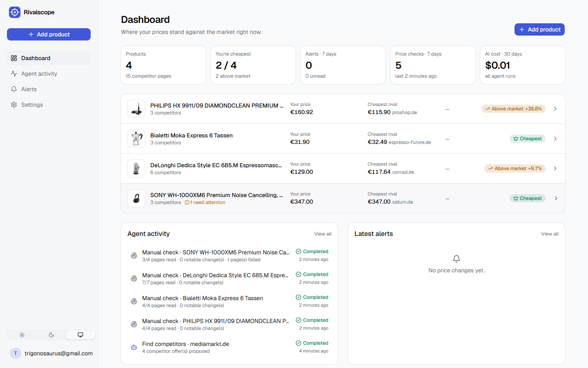
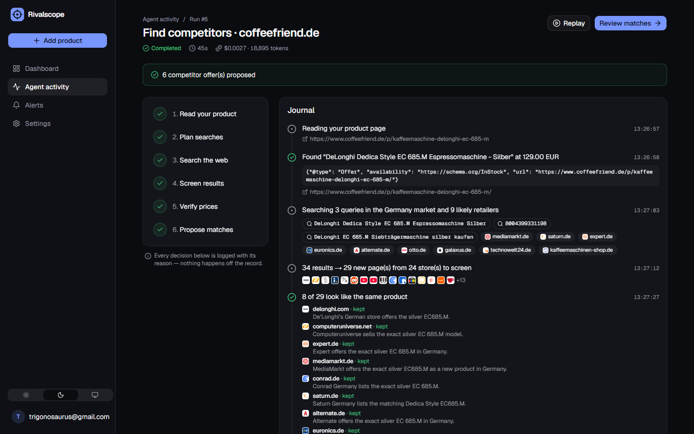
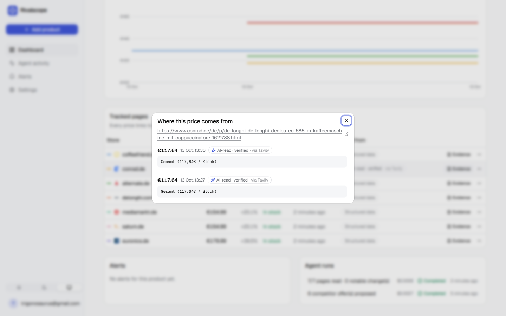

# Rivalscope — competitor price monitoring with an AI agent you can audit

[](https://github.com/trigonosaurus-rgb/e-commerce-ai-monitoring/actions/workflows/ci.yml)


Paste a product page from your store. An AI agent finds the same product in other online stores,
checks their prices on a schedule and tells you when a competitor undercuts you — and **every number
comes with the page fragment it was read from**, so nothing has to be taken on trust.



## What it does

- **Finds your competitors.** A LangGraph agent reads your product (name, brand, EAN, price), plans
  searches for your market, screens the results, opens each candidate store and verifies that it
  sells the *same* product. Matches are proposed — you approve what gets tracked.
- **Monitors prices.** Approved pages are re-checked every few hours. Prices come from the
  structured data stores publish for Google Shopping; the LLM is only a fallback.
- **Shows its work.** Every agent run is a journal: what it searched, which results it kept or
  rejected and why, what each step cost. Every price links to its evidence.
- **Alerts you** in the app, on Telegram or by email when a competitor drops below you, changes
  price or goes out of stock — with a short AI summary built only from numbers computed in code.

| The agent at work | Evidence behind a price |
|---|---|
|  |  |

## How it works

```mermaid
flowchart LR
    subgraph Discovery agent · once per product
        A[Read your page] --> B[Plan searches<br/>+ likely retailers]
        B --> C[Web search<br/>Tavily]
        C --> D[Screen results<br/>LLM]
        D --> E[Verify each store<br/>price + same product]
        E -- fewer than 2 matches --> B
        E --> F[Propose matches]
    end
    F --> H{You approve}
    subgraph Monitoring · every 12 h
        G[Fetch page] --> I[Read price<br/>JSON-LD → LLM fallback]
        I --> J[Sanity checks]
        J --> K[Snapshot + evidence]
        K --> L[Compare & alert]
    end
    H --> G
```

**Matching the same product.** EAN/GTIN codes decide when both pages have them (they usually do);
otherwise the manufacturer part number; only then the LLM compares the two listings. Used,
refurbished and other-market offers (other country or currency) are rejected with a reason.

**Reading a price.** Most shops (Shopify, WooCommerce, Shopware, Magento, big retailers) publish
schema.org `Product`/`Offer` JSON-LD — exact and free. Pages without it go to the LLM, which must
quote the page text it read the price from; the quote is checked against the page. If a store
blocks direct requests or renders prices with JavaScript, the page is fetched through Tavily
Extract. Rivalscope never disguises itself or bypasses bot protection: a blocked page is shown as
blocked.

**Not trusting a single reading.** A price that moves more than 60% in one check, or changes
currency, is stored as evidence but flagged for review instead of triggering an alert.

## Design decisions

| Decision | Why |
|---|---|
| Structured data first, LLM second | Deterministic, free and exact for most stores; the LLM handles the rest and is verified. |
| Human approval of matches | LLM product matching is good, not perfect. One click keeps wrong data out of the history. |
| Numbers in Python, words from the LLM | Alerts never contain invented numbers — the model only explains figures it is given. |
| LangGraph only for discovery | That flow has a real loop (retry with different searches). Scheduled checks are plain code. |
| State in the database, not in memory | Restarts lose nothing: overdue checks run on the next tick, cut-off runs are marked *interrupted*. |
| Polling instead of SSE | Works through any proxy, needs no reconnection logic; the UI feels just as live at 1.5 s. |
| One service | The Next.js app is exported to static files and served by FastAPI: one image, one port, same-origin cookies. |
| SSRF guard on every redirect hop | Users submit URLs the server fetches; private, loopback and metadata addresses are refused. |

## Cost

Measured on real runs (OpenAI `gpt-6-luna` for extraction/screening, `gpt-6.1-sol` for alert text):

| What | Typical cost |
|---|---|
| Discovery run (find competitors for one product) | $0.001–0.003 + ~10 Tavily credits |
| Scheduled check of a product with 4–7 pages | $0 when stores publish structured data, ~$0.0005 otherwise |
| 20 products × 4 competitors, checked twice a day | ≈ $2–4 / month in AI + Tavily free tier |

Each run's tokens and cost are shown in the UI.

## Run it locally

Requirements: [uv](https://docs.astral.sh/uv/), Node.js 24, an OpenAI key and a Tavily key.

```bash
git clone https://github.com/trigonosaurus-rgb/e-commerce-ai-monitoring.git
cd e-commerce-ai-monitoring
cp .env.example .env            # add OPENAI_API_KEY and TAVILY_API_KEY

uv sync                         # backend dependencies
uv run python -m backend.cli create-user you@example.com   # prints a password
uv run uvicorn backend.main:app --reload --port 8000

cd frontend && npm ci && npm run dev    # http://localhost:3000
```

Anonymous visitors see the read-only demo workspace; sign in to use your own. Access is
invite-only: accounts are created with the CLI, and the "Request access" form forwards requests
to the owner's Telegram.

```bash
uv run python -m backend.cli access-requests        # list requests
uv run python -m backend.cli export-demo you@example.com demo.json
uv run python -m backend.cli seed-demo demo.json    # load a workspace into the public demo
```

### Docker

```bash
docker build -t rivalscope .
docker run -p 8000:8000 --env-file .env -v rivalscope-data:/app/data rivalscope
```

The image contains the API, the scheduler, the Telegram bot and the built web app. Run a single
container per database: the scheduler lives inside the process.

### Notifications

- **Telegram:** create a bot with [@BotFather](https://t.me/BotFather), set `TELEGRAM_BOT_TOKEN`
  and `TELEGRAM_BOT_USERNAME`. Users connect their chat in Settings (no webhook needed).
- **Email:** any SMTP server (`SMTP_*` variables). For reliable delivery to customers use a
  sending service with your own domain.

## Quality

- 56 tests run offline (`uv run pytest`): price extraction on real-world page shapes, SSRF
  protection, monitoring rules, the agent graph with a fake web/LLM, the API, demo read-only mode.
- `ruff` for the backend, ESLint + TypeScript for the frontend, migrations checked against the
  models, Docker build — all in [CI](.github/workflows/ci.yml).
- `/api/health` and the Settings page show the database, scheduler, AI, search, Telegram and
  email status at a glance.

## Project structure

```
backend/
  agent/discovery.py   LangGraph agent that finds competitors
  monitor.py           price checks, sanity rules, alerts
  scheduler.py         background loop driven by Offer.next_check_at
  extraction.py        JSON-LD / microdata / meta parsing + verified LLM fallback
  fetching.py          safe page fetching (SSRF guard, Tavily fallback)
  llm.py               every OpenAI call, as typed Pydantic outputs
  events.py            the run journal shown in the UI
  notify/              Telegram and email delivery
  api/                 FastAPI routers;  auth.py: sessions, demo workspace
  migrations/          Alembic migrations, applied on startup
frontend/src/
  app/                 dashboard, product, agent run, activity, alerts, settings, login
  lib/                 typed API client, data hooks, formatting
```

## Limitations

- Sites with aggressive bot protection (e.g. Amazon) are often unreadable and shown as blocked.
- Product variants (size, color) are matched carefully, but the final word is the user's approval.
- Prices are compared only within one currency; other markets are out of scope by design.
- Price history in the demo is real and grows with time — it started in October 2026.

## License

MIT
